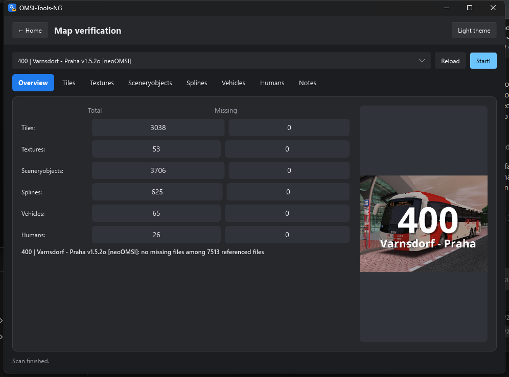

<p align="center">
  
</p>

<p align="center">
  <strong>Map verification and cleanup for OMSI 2, neoOMSI and openOMSI</strong><br>
  A modern Rust rewrite of two tools of <a href="https://github.com/pietr26/OMSI-Tools">OMSI-Tools</a> by pietr26.
</p>

<p align="center">
  
</p>

## What it does

- **Map verification** – scans a map (`global.cfg`, tiles incl. Chrono, ground textures, parklists,
  humans/drivers, AI lists, trains) and lists every missing file grouped by type, together with the
  files that reference it.
  **A referenced file counts as present if it exists in *any* configured directory** – a neoOMSI map
  using an object that lives in OMSI 2 is valid.
- **Cleanup** – finds `Sceneryobjects`, `Splines` and `Vehicles` folders that no map uses, in three
  separate lists. It previews first; nothing changes until you confirm, and folders are moved to a
  folder of your choice or to the recycle bin. **Nothing is ever hard-deleted.**
- **Fast** – a native Rust scanner: a map with 7,500 referenced files is verified in about 2 seconds, and the cleanup analysis of 51 maps and ~120 GB of content takes about 20 seconds (release build, measured on a real OMSI 2 + neoOMSI install).
- **Directories** – OMSI 2 (main), plus optional neoOMSI and openOMSI. Scans are strictly read-only.
- **Languages** – English (default), Español, Deutsch, Polski, Čeština, Français.
- **Themes** – light and dark (follows the system until you choose).

Website: [`docs/index.html`](docs/index.html) (static, can be served with GitHub Pages from `/docs`).

## Build and run

You need a recent stable Rust toolchain.

```
cargo test
cargo run -p app
```

Read-only command line helpers:

```
cargo run -p omsi-tools-core --example scan -- "<OMSI 2>" "<neoOMSI>" "<openOMSI or ->" "<map name filter>"
cargo run -p omsi-tools-core --example cleanup_preview -- "<OMSI 2>" "<neoOMSI>"
```

Settings are stored as TOML in your user config directory (shown in the Settings page).

## Layout

| Path             | Purpose                                                                  |
|------------------|--------------------------------------------------------------------------|
| `core/`          | UI-free library: config, encodings, paths, map list, scanner, cleanup    |
| `app/`           | Slint desktop application (`app/ui/main.slint`)                          |
| `app/lang/`      | `strings.txt` – every translatable string in all six languages           |
| `assets/`        | Logo, wordmark and social preview (SVG)                                  |
| `docs/`          | Project website                                                          |

Adding or changing a translation: edit `app/lang/strings.txt` (one line per string,
`English|Español|Deutsch|Polski|Čeština|Français`); `build.rs` generates everything else.

## Attribution and licence

This project is derived from OMSI-Tools (C++/Qt) by **pietr26** and from its fork OMSI-Tools-NG. The
file formats, parsing rules and the scan/cleanup behaviour were ported from that code base, so the
original credit is kept and the project is released under the **GNU General Public License v2.0**
(see [`LICENSE`](LICENSE)).

> Original work: Copyright (C) pietr26 and the OMSI-Tools contributors – <https://github.com/pietr26/OMSI-Tools>

Not affiliated with the developers of OMSI, neoOMSI or openOMSI.

See also [`CHANGELOG.md`](CHANGELOG.md) and [`CONTRIBUTING.md`](CONTRIBUTING.md).
